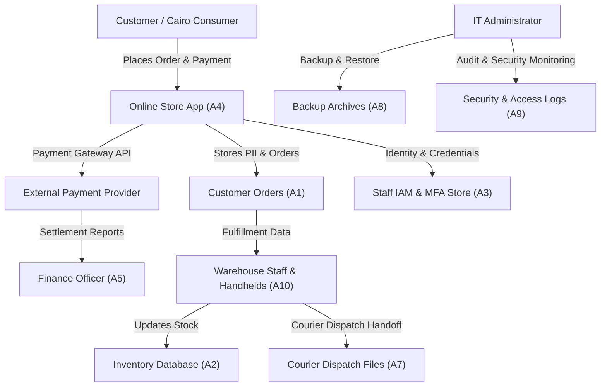

# Business Map & Data Flow (01_Business_Map_and_Data_Flow.md)
**Owner:** Student 1 (Business & Risk) | **Reviewer:** Student 2 (Governance & Policy)

---

## 1. Company Profile & Operational Scope
- **Company Name:** NileCart Egypt (Fictional e-commerce enterprise).
- **Headquarters & Operations:** Corporate office in Cairo (Downtown) and regional fulfillment warehouse in 6th of October City, Cairo.
- **Staff Headcount:** 35 employees across management, customer support, warehouse operations, finance, and IT administration.
- **Core Business Model:** Business-to-Consumer (B2C) online retail operating an e-commerce storefront, order management database, payment gateway integration, and courier logistics handoffs.
- **Systems & Technology:** Cloud-hosted store application (A4), customer order records (A1), inventory management database (A2), staff IAM & MFA directory (A3), payment settlement reports (A5), refund logs (A6), courier dispatch files (A7), backup archives (A8), security logs (A9), and warehouse handheld terminals (A10).

---

## 2. Data Flow Architecture & Stakeholders
The data flow encompasses Cairo consumers placing orders through the online storefront, payment processing via an external payment provider, settlement verification by the Finance Officer, order fulfillment by Warehouse Staff interacting with the Inventory Database, and courier dispatch handoffs managed by Operations.

### Mermaid Data-Flow Diagram

