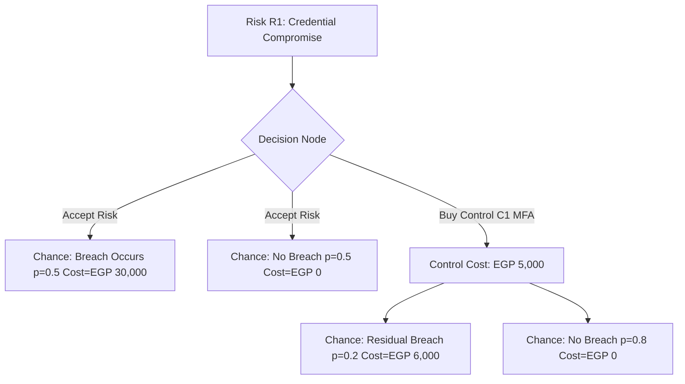
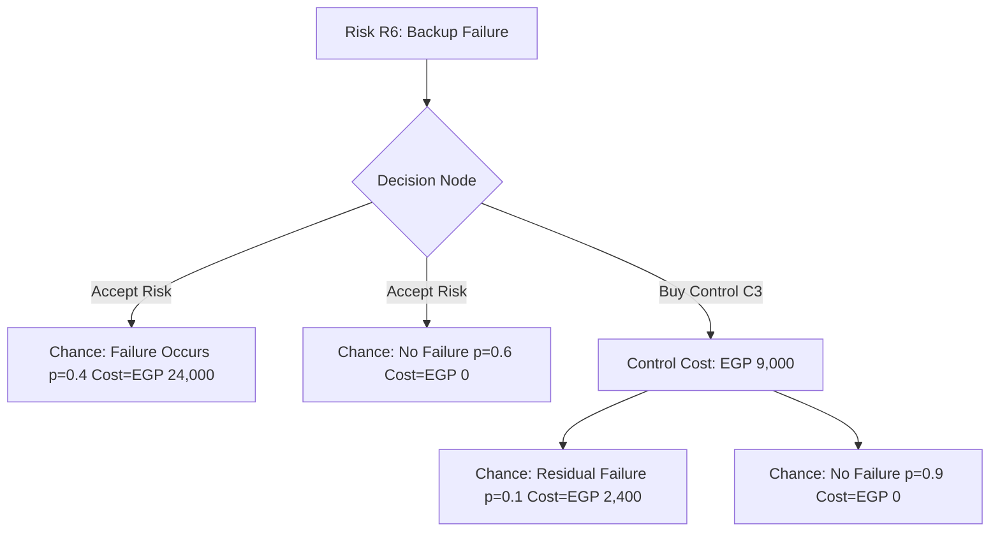

# Control Selection & Budget Decision (05_Control_Decision_and_Budget.md)
**Owner:** Student 1 (Business & Risk) | **Reviewer:** Student 2 (Governance & Policy)

---

## 1. 5×5 Risk Matrix & Rating Bands
- **Rating Bands Legend:** 
  - 1–6: **Low** (Green)
  - 7–12: **Medium** (Yellow)
  - 13–19: **High** (Orange)
  - 20–25: **Critical** (Red)

### 5×5 Matrix Placement (R1 positioned at Likelihood 4, Impact 5 = Score 20 Critical)
```text
Impact (1-5) →
        1         2         3         4         5
  ---------------------------------------------------------
L   5 | —         —         —         —         —
i   4 | —         —         —         R8 (16: High) R1 (20: Critical)
k   3 | —         —         R4 (9: Medium) R3/R5/R7 (12: Medium) R2/R6 (15: High)
e   2 | —         —         —         —         —
l   1 | —         —         —         —         —
```

---

## 2. EMV Decision Tree Analysis with Chance Nodes & Multi-Year Views
### A. Risk R1 (Credential Compromise) & Control C1 (MFA)
- **Baseline (Accept Risk):** $p = 0.5$, $\text{SLE} = \text{EGP } 30,000 \rightarrow \mathbf{ATLE = \text{EGP } 15,000\text{/yr}}$.
- **Buy Control C1 (Cost = EGP 5,000 estimated setup & tooling):** Reduces probability to $p = 0.2$. Residual loss = $0.2 \times 30,000 = \text{EGP } 6,000$.
- **Year-1 Total EMV Cost:** $\text{EGP } 5,000 + \text{EGP } 6,000 = \mathbf{EGP\ 11,000\text{ (Year-1 Total)}}$ (Net savings vs acceptance in Year 1: EGP 4,000).
- **3-Year Strategic View (Estimate):** 
  - *Accept:* $15,000 \times 3 = \text{EGP } 45,000$.
  - *Buy C1:* Setup EGP 5,000 + recurring residual loss ($6,000 \times 3 = 18,000$) = **EGP 23,000** over 3 years (saving EGP 22,000).



### B. Risk R6 (Backup Failure) & Control C3 (Protected Backups & Test)
- **Baseline (Accept Risk):** $p = 0.4$, $\text{SLE} = \text{EGP } 24,000 \rightarrow \mathbf{ATLE = \text{EGP } 9,600\text{/yr}}$.
- **Buy Control C3 (Cost = EGP 9,000 estimated setup/tooling):** Reduces probability to $p = 0.1$. Residual loss = $0.1 \times 24,000 = \text{EGP } 2,400$.
- **Year-1 Total EMV Cost:** $\text{EGP } 9,000 + \text{EGP } 2,400 = \mathbf{EGP\ 11,400\text{ (Year-1 Total)}}$ (*Note: In Year 1, buying C3 costs more than accepting the risk (11,400 vs 9,600)*).
- **3-Year Strategic View (Estimate):** 
  - *Accept:* $9,600 \times 3 = \text{EGP } 28,800$.
  - *Buy C3:* Setup EGP 9,000 + recurring residual loss ($2,400 \times 3 = 7,200$) = **EGP 16,200** over 3 years (saving EGP 12,600 long-term, plus supporting recovery for R1 and R2).



---

## 3. Final Budget Table & Justification (Exact EGP 30,000 Ceiling Allocation)
| Control ID | Control Name | Estimated Cost (EGP) | Risks Addressed | Estimated ATLE Reduction / Benefit | Priority |
|---|---|---|---|---|---|
| **C1** | Staff MFA Rollout | 5,000 | R1, R8 | EGP 9,000 / yr (Calculated) | High (1) |
| **C2** | Monthly Access Review | 3,000 | R1, R2 | Qualitative benefit / review certainty | High (2) |
| **C3** | Protected Backups & Restore Test | 9,000 | R6 | EGP 7,200 / yr (3-yr net positive) | High (3) |
| **C4** | Staff Awareness Training | 2,000 | R8 | Qualitative benefit (quiz/tabletop readiness) | Medium (4) |
| **C5** | Refund Dual Approval | 4,000 | R5 | Qualitative benefit / segregation enforcer | Medium (5) |
| **C6** | Private-by-Default Cloud Sharing | 3,000 | R2 | Mitigates public link sharing exposure | High (6) |
| **Total Invested** | — | **26,000** | — | — | — |
| **Contingency** | — | **4,000** | Reserved | — | — |
| **Total Ceiling** | — | **30,000** | — | — | — |
